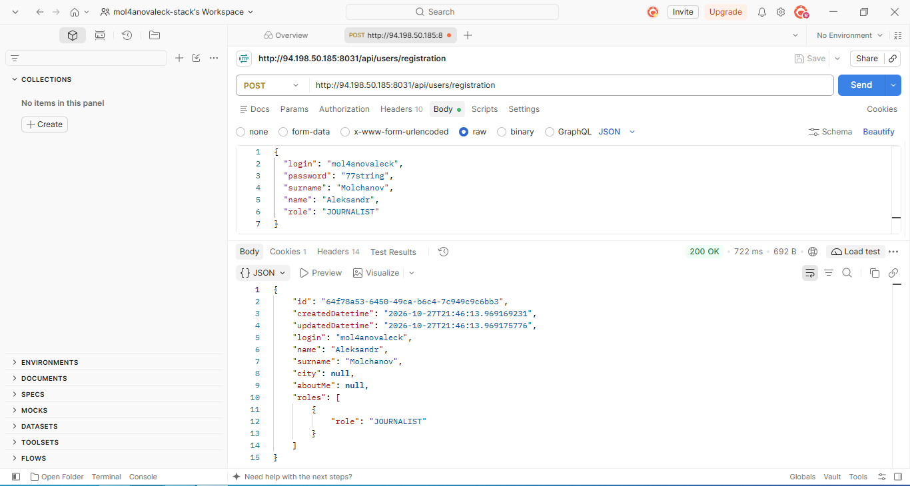
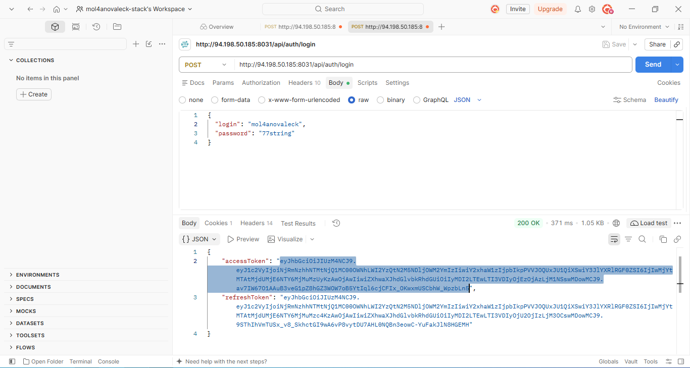
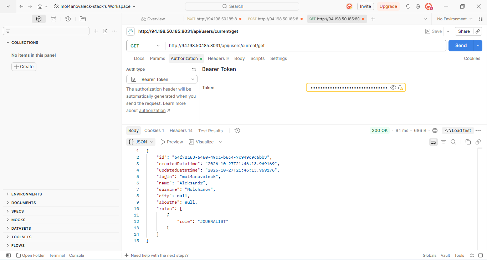

### 1. Регистрация (Registration)
Успешный ответ сервера (200 OK) на создание пользователя.

### 2. Логин (Authentication)
Успешное получение токена (200 OK).

### 3. Получение данных текущего пользователя (Get Current User)
Успешный запрос с использованием Bearer Token (200 OK).

